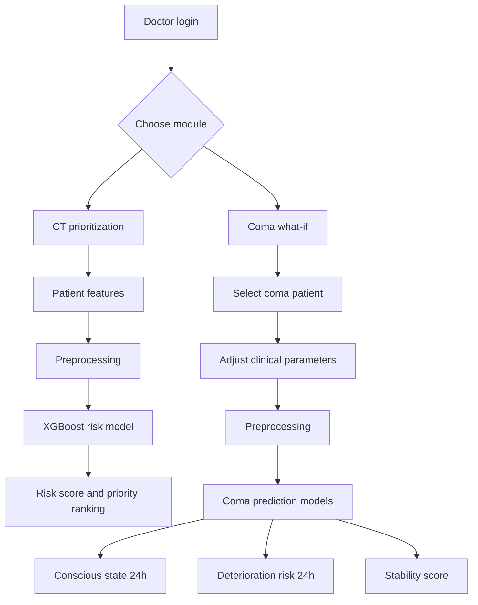

<div align="center">

# NeuroMate

**AI clinical decision support for traumatic brain injury and coma care**

CT scan triage · Coma recovery digital twin · What-if simulation


</div>

---

## Overview
Neurological emergencies such as traumatic brain injury (TBI) and coma are among the most time-critical cases in healthcare, and in resource-constrained hospitals, CT scanners and specialist attention are limited. NeuroMate is a web-based decision-support platform that helps emergency physicians and radiology departments decide **who needs imaging first**, and **what a coma patient's next 24 hours are likely to look like**.

The platform combines two clinical modules in one system: a risk-based CT prioritization engine and a digital twin that lets clinicians test physiological changes before acting on them.

## Key features

### CT scan prioritization
- Predicts whether a TBI patient needs urgent CT imaging within 24 hours
- Generates a risk score, a risk level, and a priority rank, so patients are ordered by medical urgency rather than arrival order
- Uses clinical and neurological indicators including GCS, TBI severity, loss of consciousness duration, amnesia duration, vomiting, headache severity, mechanism of injury, seizure type, and pupillary reaction

### Coma digital twin and what-if simulation
- Builds a virtual representation of each coma patient from their clinical record
- Predicts **conscious state at 24 hours**, **deterioration risk at 24 hours**, and a **stability score (0–100)**
- Lets clinicians adjust oxygen saturation, mean arterial pressure, temperature, sedation level, and head position, and see the predicted impact immediately

### Platform
- Role-based dashboards for doctors, students, and administrators
- Patient management with structured, validated clinical data entry
- Secure authentication and authorization with JSON Web Tokens (JWT)
- Interactive 3D brain model

## Results

| Module | Model | Result |
|---|---|---|
| CT scan prioritization | XGBoost | Recall ≈ 93%, AUC 0.96 |
| Coma outcome prediction | XGBoost | Weighted recall ≈ 97% |
| Stability and deterioration scores | XGBoost Regressor | Low prediction error, stable performance |

For CT prioritization, XGBoost was compared against Logistic Regression and Random Forest using accuracy, precision, recall, F1-score, and ROC-AUC, and outperformed both across most metrics. The coma module compared XGBoost against a Logistic Regression baseline.

## How it works



## Architecture

```
NeuroMate/
├── AI/          # Training notebooks and experiments
├── backend/     # FastAPI services, authentication, prediction endpoints
├── frontend/    # React clinician interface
├── models/      # Trained models and 3D brain asset
└── README.md
```

| Layer | Technology |
|---|---|
| Machine learning | Python, XGBoost, scikit-learn |
| Backend | FastAPI, JWT authentication |
| Database | MySQL (patients, predictions, users, activity logs) |
| Frontend | React |

## Getting started

**Prerequisites:** Python 3.10+, Node.js, MySQL

```bash
git clone https://github.com/maya-khammash/NeuroMate.git
cd NeuroMate
cp .env.example .env      # add your database and secret key values
```

Start the backend and frontend with the provided scripts: `start.bat` / `start.ps1` on Windows, and `stop.bat` / `stop.ps1` to shut them down.

## Data
Real clinical datasets for TBI and coma patients are protected by privacy regulations and access agreements. NeuroMate was therefore developed on **synthetic datasets** generated from medically realistic parameters drawn from clinical guidelines and published research, and reviewed through literature review and expert consultation. We approached hospitals and TBI centers in Europe and the United States for clinical data, and those partners require longer data-access processes. The preprocessing and modeling pipeline can be retrained on clinical data as access is granted.

## Scope
NeuroMate is intended as a decision-support tool for clinicians, who remain responsible for patient care decisions.

## Future work
- Training on larger, more diverse clinical datasets
- Integration with hospital information systems and real-time patient monitoring
- Advanced digital twin capabilities and richer visualization
- Educational mode that lets trainees work through simulated patient cases

## Recognition
Presented at the National Technology Parade (NTP-13), 2026.